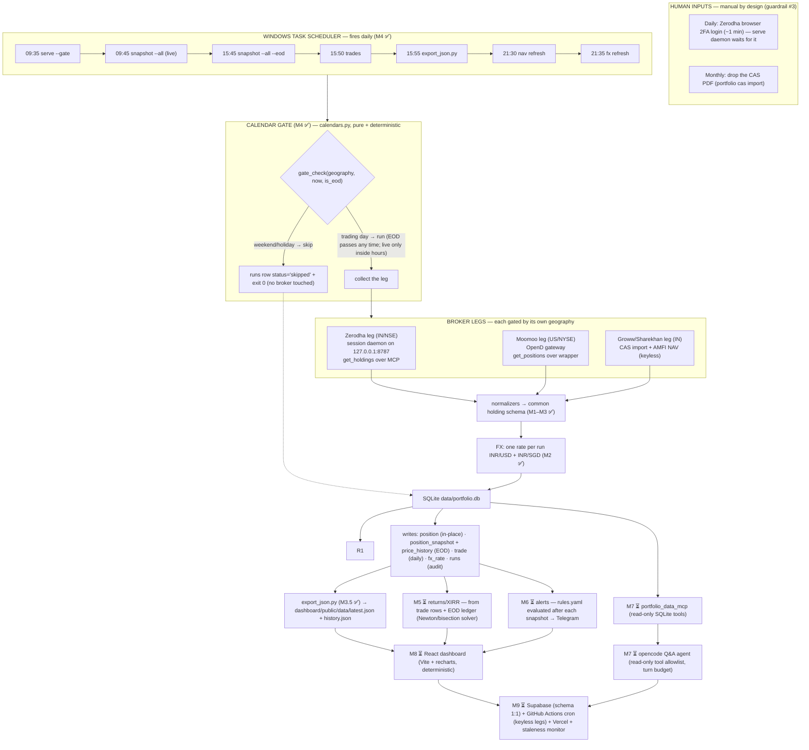

# Application Flow — Agentic Portfolio Dashboard

How the whole system works, one picture. Status markers: ✅ built · ⏳ to do.
Times are IST. This file mirrors PLAN.md — the plan is the source of truth.

## One-paragraph summary

Three lanes, deliberately separated:

1. **The daily machine (deterministic pipeline, M0–M6).** Windows Task Scheduler fires
   7 jobs daily. Each calls a CLI command that runs through the **calendar gate**
   (`calendars.py`): on a holiday/weekend it writes an audited `skipped` row in `runs`
   and exits 0 (a no-op, not a failure). On a trading day it collects each broker's
   holdings (Zerodha via a session daemon that holds the daily manual 2FA login,
   Moomoo via the local OpenD gateway), normalizes them to one common schema, applies
   one FX rate per run, and upserts into SQLite — live state in `position`, the daily
   ledger in `position_snapshot`/`price_history` on EOD runs, and one audit row per
   attempt in `runs`.
2. **The dashboard (deterministic, M8 ⏳).** Each run ends with `export_json.py`
   writing `latest.json` + `history.json` (M3.5: the value history is *derived* from
   the ledger, never written). A React app renders those files. No LLM anywhere.
3. **The agent (M7 ⏳).** A Q&A chat on top of the same SQLite via a read-only
   `portfolio_data_mcp`, running inside opencode with a strict read-only tool
   allowlist. The dashboard never depends on it.

The pipeline is deterministic (identical input → identical output). The LLM touches
only M7 and the dashboard chat. Guardrails (no order tools, no automated login,
secrets in gitignored `data/tokens.json`) apply to every box below.

## Flowchart (Mermaid)



## Flowchart (ASCII — renders anywhere)

```
 HUMAN INPUTS (manual by design)                 WINDOWS TASK SCHEDULER (M4 done) — fires DAILY
 ┌─────────────────────────────────┐             ┌────────────────────────────────────────────┐
 │ • Daily: Zerodha 2FA login      │             │ 09:35 serve --gate (daemon + wait 2FA)     │
 │   (~1 min, serve waits for it)  │             │ 09:45 snapshot --all        (live poll)     │
 │ • Monthly: drop the CAS PDF     │             │ 15:45 snapshot --all --eod (EOD ledger)     │
 └─────────────────────────────────┘             │ 15:50 trades                (XIRR input)    │
                                                 │ 15:55 export_json.py        (dashboard JSON)│
                                                 │ 21:30 nav refresh (AMFI NAV, keyless)       │
                                                 │ 21:35 fx refresh  (FX rate,  keyless)       │
                                                 └──────────────────────┬─────────────────────┘
                                                                       │
                                                 CALENDAR GATE (M4 done) ▼
                                                 ┌─────────────────────────────────────────┐
                                                 │ gate_check(geography, now, is_eod)      │
                                                 │   weekend/holiday → SKIP                │
                                                 │   trading day   → run                   │
                                                 └────────────┬────────────────────────────┘
                              skip: runs row 'skipped' + exit 0 │ run: collect the leg
                              (holiday ≠ failure, broker never  │
                               touched)                          ▼
                                      ┌──────────────────┬────────────────────┐
                                      ▼                  ▼                    ▼
                              ┌──────────────┐  ┌──────────────┐  ┌────────────────────┐
                              │ ZERODHA leg  │  │ MOOMOO leg   │  │ GROWW/SHAREKHAN leg │
                              │ IN · NSE     │  │ US · NYSE    │  │ IN · CAS + AMFI NAV │
                              │ session      │  │ OpenD        │  │ free CAS import +   │
                              │ daemon RPC   │  │ gateway      │  │ keyless NAV feed    │
                              └──────┬───────┘  └──────┬───────┘  └─────────┬──────────┘
                                     └─────────┬───────┘                    │
                                               ▼                           │
                                     normalizers → common schema ──────────┘
                                               ▼
                                     FX: one rate per run (INR/USD, INR/SGD)
                                               ▼
                                     SQLite data/portfolio.db
                                     • position (live state, in-place)
                                     • position_snapshot + price_history (EOD ledger)
                                     • trade (daily) · fx_rate · runs (audit: ok/skipped/error)
                                               │
                    ┌──────────────────────────┼──────────────────────────────┐
                    ▼                          ▼                              ▼
        M5 (todo) returns/XIRR       export_json.py (done)        M6 (todo) alerts
        from trade rows +           → latest.json + history.json  rules.yaml → Telegram
        EOD ledger, solver          → dashboard/public/data/      (dedupe per rule+day)
                    │                          │                              │
                    └──────────────┬───────────┘                              │
                                   ▼                                          │
                    ┌───────────────────────────┐                             │
                    │ M8 (todo) React dashboard │                             │
                    │ Vite + recharts, static   │                             │
                    │ JSON, Refresh-now bridge  │◄────────────────────────────┘
                    └─────────────┬─────────────┘
                                  │        SQLite → M7 (todo) portfolio_data_mcp
                                  │        → opencode Q&A agent (read-only allowlist)
                                  ▼
                    M9 (todo) Supabase (schema 1:1) + GitHub Actions cron
                    (keyless legs move to cloud) + Vercel + staleness monitor
```

## Feature status

| # | Feature | Status | How it works |
|---|---|---|---|
| M0 | Scaffold: uv project, DB schema, redaction logging | ✅ | `portfolio db migrate`; secrets never logged |
| M1 | Zerodha end-to-end | ✅ | Session daemon holds the daily manual 2FA login; snapshots reach it over loopback RPC |
| M2 | Moomoo + consolidated view | ✅ | OpenD gateway + read-only wrapper; one FX rate per run; allocation sums to 100% |
| M3 | Groww via free CAS import + trade capture | ✅ | `casparser` parses the monthly CAS; AMFI NAV refreshes MF/ETF prices daily |
| M3.5 | Hardening (audit every failure, derived value series, freshness) | ✅ | 4 MAJOR review findings closed; `history.json` derived from the EOD ledger |
| M4 | Scheduling + calendars | ✅ | 7 daily Task Scheduler jobs; `calendars.py` gate skips+logs holidays/weekends; `--force` override; year-rolling holiday files |
| M5 | Returns & XIRR | ⏳ | Per-holding return from cost basis; XIRR solver over `trade` rows + current value |
| M6 | Alerts (rule-based only) | ⏳ | `rules.yaml` (drop %, target/stop, RSI/MA) evaluated after each snapshot → Telegram, deduped per day; no AI |
| M7 | Q&A agent | ⏳ | Read-only `portfolio_data_mcp` over SQLite inside opencode; tool allowlist + turn budget; eval set |
| M8 | Dashboard | ⏳ | React + recharts reading the JSON contract; Refresh-now triggers an on-demand pipeline run |
| M9 | Deploy | ⏳ | SQLite → Supabase (shared spine); keyless legs → GitHub Actions cron; dashboard → Vercel; staleness monitor |

## The two-kinds-of-work split (why the arrows go where they do)

- **Manual-token legs stay on the always-on Windows box:** Zerodha daemon (the daily 2FA
  is regulatory — never automated) and Moomoo OpenD (a desktop app).
- **Keyless legs can move to the cloud in M9:** CAS import, AMFI NAV, FX refresh, alert
  evaluation, dashboard export → GitHub Actions cron; dashboard → Vercel. SQLite's
  single-writer rule is why they all share one store until the Supabase migration.
